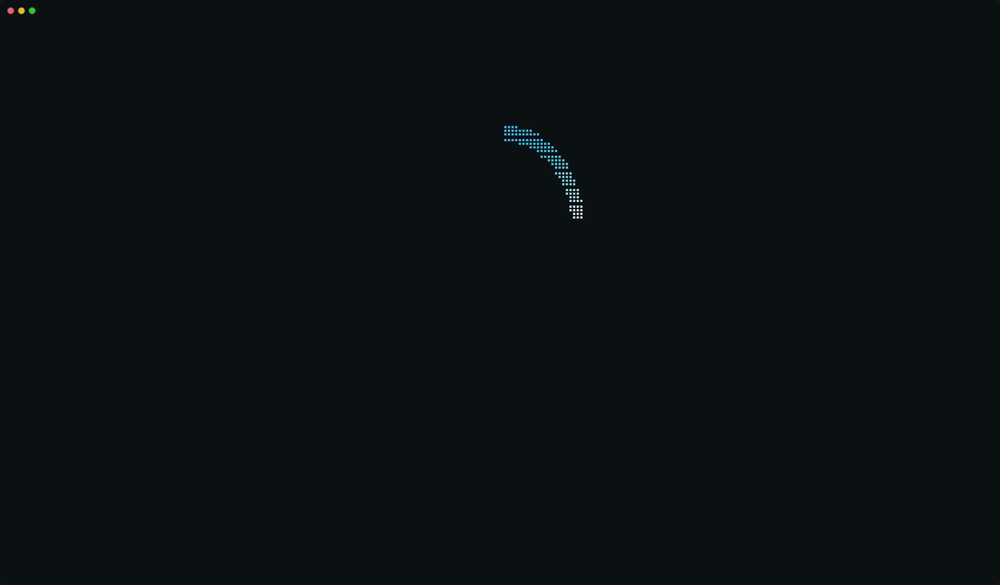
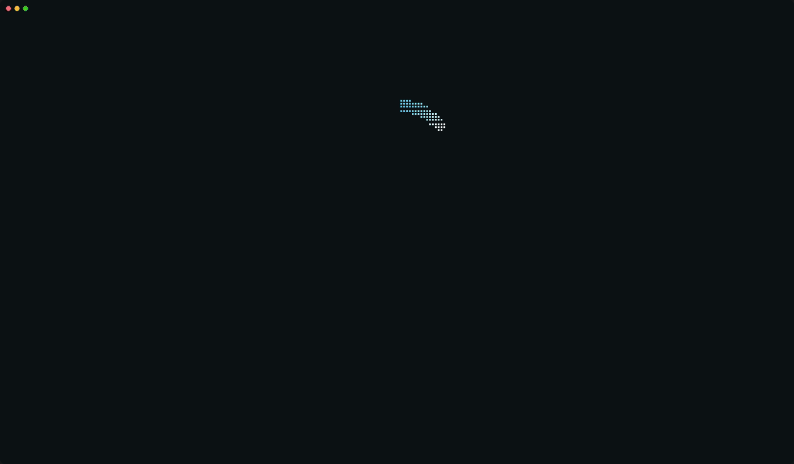
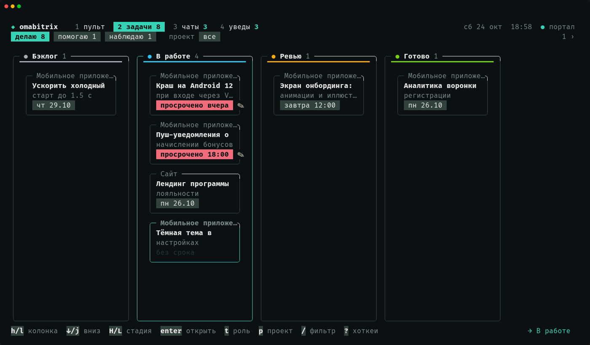
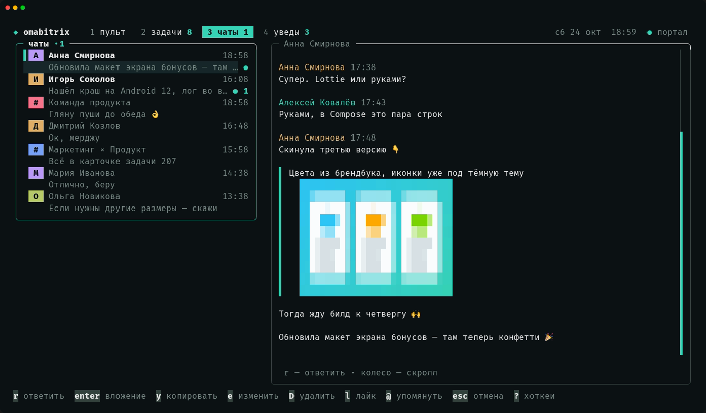
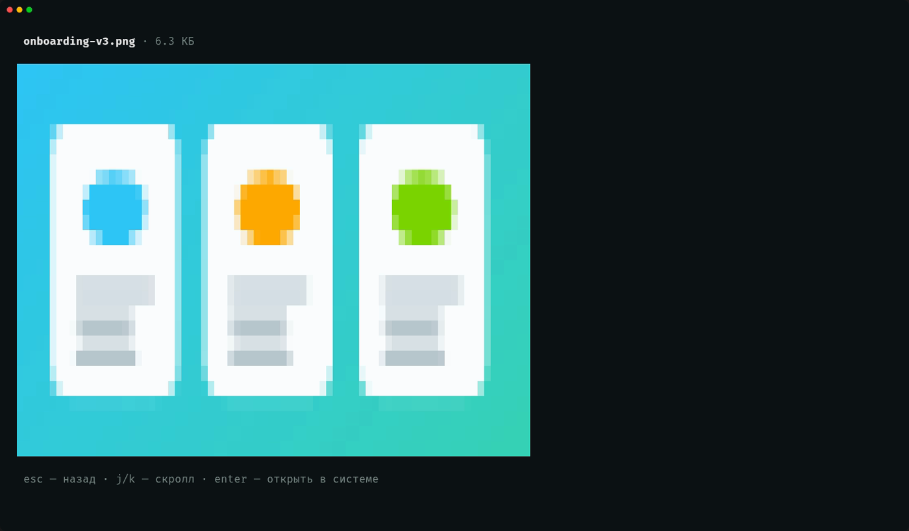
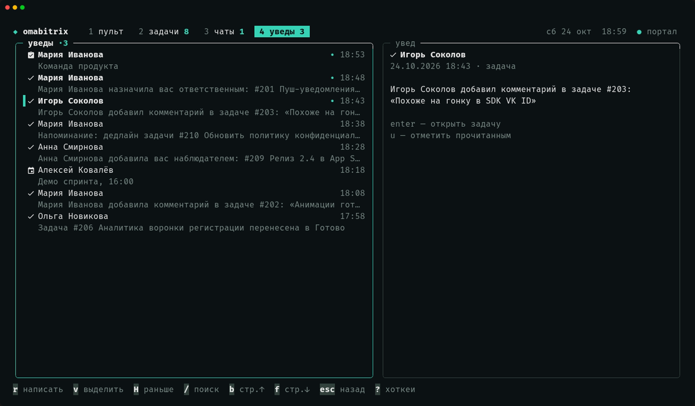

<p align="center">
  
</p>

<h1 align="center">omabitrix</h1>

<p align="center">
  <b>Bitrix24 в терминале.</b><br>
  Чаты, канбан задач и уведомления с клавиатуры, без вкладки браузера.<br>
  Демон шлёт тосты, бар <a href="https://omarchy.org">Omarchy</a> показывает непрочитанное.
</p>

<p align="center">
  <a href="https://github.com/oglenyaboss/omabitrix/actions/workflows/ci.yml"></a>
  
  <a href="LICENSE"></a>
</p>

## Попробовать без портала

Встроенный демо-портал с выдуманной командой — без конфига, вебхука и сети:

```bash
go run github.com/oglenyaboss/omabitrix/cmd/omabitrix@latest -demo
```

<p align="center">
  
</p>

| | |
|---|---|
|  |  |
|  |  |

Компаньон [Bitrix24](https://bitrix24.ru) для рабочего стола: собран под Omarchy, подойдёт любому Arch + Hyprland. Демон следит за порталом через входящий вебхук (никаких OAuth и серверов), TUI закрывает рутину: ответить в чате, двинуть задачу по канбану, погасить уведомление.

## Возможности

- **Чаты**: история с аватарами и группировкой, ответы-цитаты, правка/удаление, лайки, упоминания, поиск по истории. **Вложения**: картинки — инлайн-превью прямо в истории и полноэкранный просмотр (клик или `v`→`enter`), файлы — скачать и открыть. Отправка: `a` — файл с подписью, `ctrl+v` — скриншот из буфера.
- **Задачи**: канбан по стадиям проектов, перенос карточек (`H`/`L` и мышью), роли, дедлайны и просрочки, чат задачи рядом с карточкой.
- **Уведомления**: список с догрузкой, прочитано/непрочитано, переход в задачу.
- **Демон**: тосты с идемпотентностью (личные сообщения, упоминания, комментарии в задачах, дедлайны), DND-окно, снапшот счётчиков для бара.
- **Omarchy-плагин**: одна иконка в баре с бейджем непрочитанных; клик — TUI, ПКМ — портал.

## Установка

Нужны: Go 1.27+, терминал с truecolor (foot/kitty/ghostty), аккаунт портала с правом создать входящий вебхук (права `im` + `task` + `disk`).

```bash
git clone https://github.com/oglenyaboss/omabitrix
cd omabitrix
make build
./bin/omabitrixd -setup
```

`-setup` — весь онбординг одной командой: спросит портал и вебхук, проверит связь, положит бинари в `~/.local/bin`, поставит и запустит systemd-юнит, предложит поставить виджет в бар Omarchy (с бэкапом `shell.json`). Идемпотентен — запускай после каждого `git pull`.

Вебхук создаётся на портале: **Приложения → Вебхуки → Добавить** → права «Чат и уведомления» (`im`), «Задачи» (`task`) и «Диск» (`disk` — вложения чатов ходят через Диск).

Осталось руками — глобальный хоткей `SUPER+B` в `~/.config/hypr/bindings.lua`:

```lua
o.bind("SUPER + B", "Bitrix24", o.launch_sole("^omabitrix$", "foot -a omabitrix omabitrix"))
-- по желанию — плавающим окном:
o.window("^omabitrix$", { float = true, center = true, size = { 1280, 800 } })
```

Без Omarchy демон и TUI работают и так: снапшот пишется в `~/.local/state/omabitrix/snapshot.json`, тосты — через `notify-send`-совместимый `omarchy-notification-send` (подхватывается из PATH).

## Состав

| Кусок | Что делает |
|---|---|
| `cmd/omabitrixd` | демон: polling-цикл (`batch` ≤50 команд), тосты с идемпотентностью, снапшот для бара; `-setup` — онбординг, `-doctor` — проверка портала |
| `cmd/omabitrix` | TUI (bubbletea): вкладки пульт/задачи/чаты/уведы, вложения, ответы, канбан; `-demo` — встроенный фейковый портал, `-trailer` — ролик-трейлер на нём |
| `plugin/lenya.omabitrix` | QML-виджет бара Omarchy: иконка + бейдж непрочитанных |
| `internal/*` | `b24` (REST-клиент с rate-limit), `rules` (классификация/DND/идемпотентность), `state` (атомарный state+snapshot), `notify`, `daemon`, `setup`, `tui`, `demo` (фейковый портал для `-demo`) |

## Проверка

```bash
make test                        # go vet + go test
systemctl --user status omabitrix
cat ~/.local/state/omabitrix/snapshot.json
```

Тост: чужое личное сообщение, упоминание, комментарий в твоей задаче, дедлайн ≤1 ч, просрочка (раз в сутки). Клик по тосту — карточка или чат. Ночь (DND) — тишина, всё в счётчике. Горячие клавиши TUI — `?` внутри.

Гифки и скриншоты в README пересобираются из демо: `make build && vhs scripts/intro.tape && vhs scripts/tour.tape` (нужны [vhs](https://github.com/charmbracelet/vhs) и ttyd). Трейлер `docs/assets/trailer.mp4` (1080p, весь кадр — живой терминал) — `scripts/trailer.sh`, ещё нужен ffmpeg.

Спека и ресёрч: [docs/SPEC.md](docs/SPEC.md) · [docs/research/](docs/research/)

## Известные потолки

- Задержка = интервал опроса (10 с); push (исходящий вебхук/OAuth) — в бэклоге.
- Один юзер на портал: вебхук действует от его имени; очередь событий `im.v2` эксклюзивна на юзера.
- Вложения: старые сообщения с `[DISK FILE ID]` без `FILE_ID` не показываются; в результатах поиска превью не рисуются.
- Телефония, кнопки в тостах, реакции в TUI — бэклог.

## Лицензия

[MIT](LICENSE)
